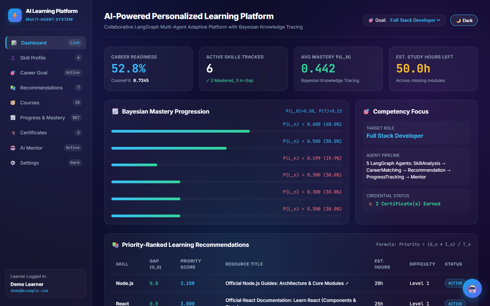
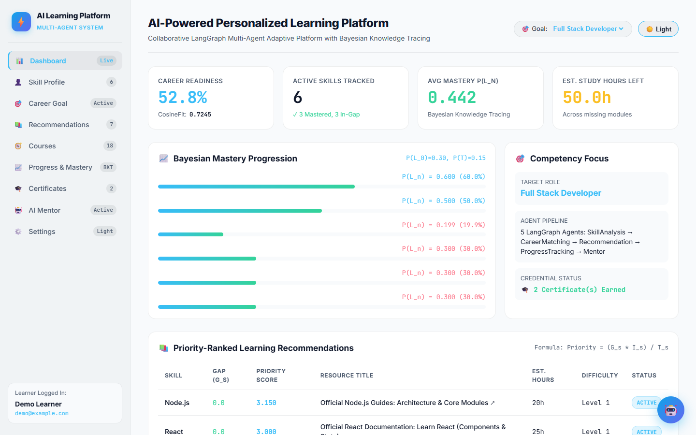
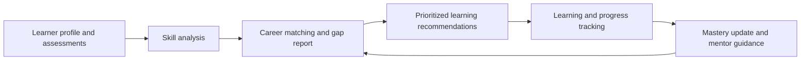

# AI-Powered Personalized Learning Platform

An adaptive learning dashboard that analyzes a learner's skills against a career goal, prioritizes learning resources, and updates mastery estimates as they progress.


## Screenshots

<p align="center">
  
  
</p>

## What it does

- Builds a skill profile from self-assessments, quiz results, and project evidence.
- Compares a learner's profile with a target career and reports skill gaps and readiness.
- Ranks learning resources by skill gap, role importance, and estimated study time.
- Tracks mastery using Bayesian Knowledge Tracing and adjusts recommendations after assessments.
- Coordinates skill analysis, career matching, recommendations, progress tracking, and mentoring through five agents.
- Provides a React dashboard, authenticated FastAPI endpoints, and downloadable completion certificates.
- Supports optional AI mentoring through providers including Groq, NVIDIA NIM, OpenRouter, OpenAI, Gemini, and Claude.

## How the learning flow works



## Tech stack

| Area | Technologies |
| --- | --- |
| Frontend | React, Vite, JavaScript |
| API | FastAPI, Pydantic |
| Agents and learning logic | LangGraph, deterministic skill and recommendation formulas |
| Persistence | SQLAlchemy, SQLite |
| Authentication and certificates | JWT, password hashing, ReportLab |

## Run locally

### Requirements

- Python 3.12 or newer
- Node.js 18 or newer and npm

### 1. Start the backend

From the project root, create a virtual environment and install the backend packages:

```powershell
py -m venv venv
.\venv\Scripts\Activate.ps1
python -m pip install fastapi "uvicorn[standard]" sqlalchemy "pydantic[email]" pyjwt slowapi cryptography reportlab langgraph httpx
$env:PYTHONPATH = "backend"
python -m uvicorn app.main:app --reload --host 127.0.0.1 --port 8000
```

The API initializes its SQLite database and demo data at startup. API documentation is available at [http://127.0.0.1:8000/docs](http://127.0.0.1:8000/docs).

### 2. Start the frontend

In a second terminal, from the project root:

```powershell
cd frontend
npm ci
npm run dev
```

Open the Vite URL shown in the terminal (usually [http://localhost:5173](http://localhost:5173)). The development server proxies API requests to the backend on port 8000.

The demo account used by the app is:

```text
Email:    demo@example.com
Password: DemoPass123!
```

### Optional AI mentor

The platform can run without an external AI provider. To enable one, configure a provider and API key in the app's Settings, or set `MENTOR_LLM_PROVIDER` and `MENTOR_LLM_API_KEY` in the backend environment. Keep real API keys out of source control.

For local development, set a private JWT signing key before starting the backend:

```powershell
$env:JWT_SECRET = "<generate-a-long-random-secret>"
```

Do not use the development default for a public deployment.

## Tests

Install the test runner if needed, then run the backend tests from the project root:

```powershell
python -m pip install pytest
$env:PYTHONPATH = "backend"
python -m pytest backend/tests
```

The repository also includes focused QA scripts under `backend/qa`.

## Repository layout

```text
backend/
  app/                 FastAPI routes, agents, models, formulas, and services
  tests/               Backend tests
  qa/                  QA and end-to-end verification scripts
frontend/
  src/                 React application and components
frontend-verification*.png
                       Dark- and light-mode screenshots
run.ps1                Windows backend launch helper
```
