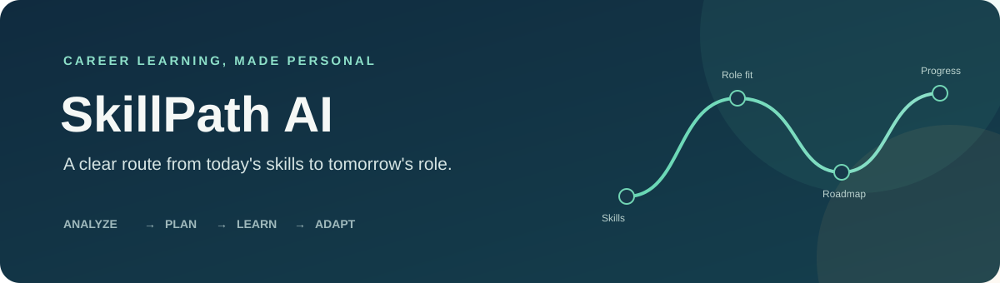
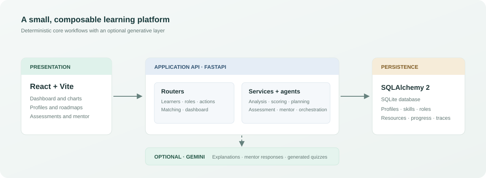

<div align="center">
  

  <p><strong>Turn a career goal into a practical, adaptive learning path.</strong></p>

  <p>
    
    
    
  </p>
</div>

SkillPath AI is a career-readiness dashboard that connects a learner's current skills to a target role. It analyzes skill gaps, compares career paths, and builds an ordered roadmap that adapts as the learner completes resources, takes assessments, or changes goals.

## Product Overview



The dashboard brings together readiness metrics, skill analysis, career matching, roadmap progress, assessments, and a learning mentor. The backend keeps scoring and matching deterministic; Gemini is optional and is used for generated explanations, mentor responses, and quiz content.

### Learning loop

1. Create a learner profile and choose a target career.
2. Compare existing skills with the role's weighted requirements.
3. Generate a prerequisite-aware learning roadmap.
4. Complete resources and submit skill assessments.
5. Recalculate readiness and adapt the next learning steps.

## Features

- Weighted role matching with clear missing, weak, and satisfied skill gaps.
- Skill analysis, readiness scoring, and a progress dashboard.
- Agent-coordinated roadmap generation with prerequisite-aware resources.
- Assessment-driven interventions that add remedial or advanced practice.
- Goal changes that rebuild the roadmap while retaining mastered skills.
- Learning mentor and quiz generation powered optionally by Gemini.
- Demo learner data and a deterministic offline mode for local development.
- FastAPI interactive documentation at `/docs`.

## Technology

| Area | Stack |
| --- | --- |
| Frontend | React, Vite, Tailwind CSS, Recharts, Lucide |
| API | FastAPI, Pydantic |
| Persistence | SQLAlchemy 2, SQLite |
| Agent workflows | Python services and coordinated learning agents |
| Optional language model | Google Gemini API |
| Tests | pytest, HTTPX |

## Run Locally

Prerequisites: Python 3.10 or later and Node.js 18 or later.

### 1. Start the API

From the repository root, create and activate a virtual environment, then install the backend dependencies:

```powershell
py -m venv .venv
.venv\Scripts\Activate.ps1
py -m pip install -r requirements.txt
```

Seed the demo learner and learning catalog, then start the API:

```powershell
py seed.py
py -m uvicorn main:app --reload
```

The API is available at `http://127.0.0.1:8000`; interactive API docs are at `http://127.0.0.1:8000/docs`.

### 2. Start the dashboard

In a second terminal:

```powershell
cd frontend
npm install
npm run dev
```

Open the Vite URL shown in the terminal, usually `http://localhost:5173`.

### Optional Gemini setup

The application works without an API key. It uses deterministic offline responses when no key is configured. To enable Gemini-backed responses and quiz generation, copy `.env.example` to `.env`, add your key, and set `LLM_MODE` to a non-mock value:

```dotenv
GEMINI_API_KEY=your-key
GEMINI_MODEL=gemini-2.0-flash
LLM_MODE=gemini
```

Never commit `.env` or other secrets.

## Configuration

| Variable | Default | Description |
| --- | --- | --- |
| `DATABASE_URL` | `sqlite:///./backend/data/skillpath.db` | SQLAlchemy database URL |
| `ALLOWED_ORIGINS` | `http://localhost:5173,http://127.0.0.1:5173` | Comma-separated browser origins allowed by the API |
| `GEMINI_API_KEY` | unset | Optional Gemini API key |
| `GEMINI_MODEL` | `gemini-2.0-flash` | Gemini model used for generated content |
| `LLM_MODE` | unset | Set to `mock` to force deterministic offline responses |
| `VITE_API_BASE_URL` | `http://127.0.0.1:8000` | API URL used by the Vite frontend |

## Tests and Build

Run the backend tests from the repository root:

```powershell
py -m pytest
```

Build the frontend:

```powershell
cd frontend
npm run build
```

## Project Layout

```text
backend/
  agents/       Learner analysis, planning, assessment, mentor, and orchestration
  models/       SQLAlchemy entities
  routers/      REST API endpoints
  services/     Matching, scoring, dashboard, and skill analysis
frontend/       React and Vite dashboard
tests/          Backend workflow and service tests
docs/assets/    README illustrations
main.py         FastAPI application entry point
seed.py         Demo catalog and learner initialization
```
